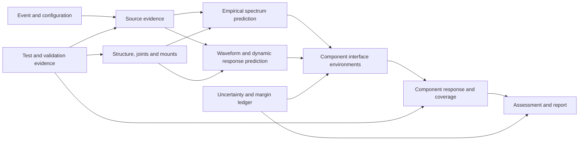

# Technical framework: shock prediction and attenuation

20 October 2026 · proposed architecture · research basis in [RESEARCH.md](RESEARCH.md).

Implementation update: the [version 1.0 workbench](README.md) now implements the empirical/measurement foundation and linear SDOF isolation. This document remains the broader architecture; FRF/MIMO, FE/SEA, statistical uncertainty and physical hardware validation are still roadmap items. See [executed verification](VALIDATION.md) for the implemented scope.

## 1. The engineering question

The tool should answer: **For a particular event and flight configuration, what shock reaches each component interface, what could amplify or attenuate it, and what evidence supports the resulting assessment?**

The useful result is a frequency-dependent environment with an identified source, path, direction, bandwidth, uncertainty basis, and verification status. A single peak-g value or a source-to-component distance is insufficient.

Use one project model for five related activities:

1. Estimate preliminary environments when detailed models do not exist.
2. Compare component locations, mounting concepts, and attenuation treatments.
3. Refine estimates using measured source, transfer, or system-response data.
4. Compare component environments with requirements and demonstrated capability.
5. Plan the next test or model improvement that most reduces decision uncertainty.

The initial scope is spacecraft/launch-vehicle structural shock. Transport/drop, landing, docking, valve actuation, and deployment impacts fit the same event architecture but need separate source and validation families. Fluid transients and airborne blast require appropriate external models before their structural loads enter this workflow.

## 2. Overall architecture



Represent the structure as a graph for **configuration, connectivity, evidence, and model selection**. Do not assume that multiplying scalar edge gains solves a connected elastic structure. Branches, reflections, loading, and closed loops require a calibrated whole-path empirical mapping or a compatible dynamic model.

The basic analysis unit is:

`event × configuration × component interface × output direction × prediction method × uncertainty scenario`.

An event can change the configuration. A separation study may need different attachment states before release, during release, and after release. A fixed linear transfer model is valid only over the interval/configuration it represents.

## 3. Source taxonomy and representation

Separate **device family**, **mechanical mechanism**, **spatial support**, and **available input representation**. Do not make these a single dropdown.

| Source family | Mechanical description for prediction | Spatial support | Evidence/parameters to retain | Preferred starting point |
|---|---|---|---|---|
| Separation bolt, frangible bolt, separation nut | Local impulsive loading, preload release, possible captured-part impact | Point or small attachment region | Device/configuration ID, preload condition, local structure, reference location, axes, event timing, capture behavior | Measured histories or SRS on a representative fixture |
| Pin puller/pusher, cutter, pyrotechnic actuator | Actuator reaction plus release/contact transients | Local region; possibly several attachments | Reaction interface, moving-part state, mounting, measurement location, secondary events | Device/assembly characterization |
| Linear shaped charge (LSC), linear cutting system | Spatially distributed cutting/separation excitation | Finite line/polyline | Installed source path, local structure, activation sequence, measured source/interface response | Representative line-source tests or external equivalent loads |
| Expanding-tube/frangible joint | Distributed excitation and changing connectivity | Line, arc, or closed ring | Joint geometry/configuration identity, release progression, interface sides, structural states | Characterized assembly or external transient simulation |
| Clampband or Marman-type release | Stored strain-energy release, band motion, distributed contact/recoil | Ring plus local release sites | Ring/mating structure, preload state, release locations, restraints and catches | Clampband-specific heritage or test |
| Non-explosive release mechanism | Preload release and subsequent contact, even without energetic initiation | Point or attachment region | Actuator class, load state, released-part capture and timing | Measured release/impact sequence |
| Deployment stop, latch, hinge, docking/contact, landing impact | Contact force, momentum change, potential nonlinear mount motion | One or several contact regions | Relative motion, effective moving mass, contact law/equivalent force history, boundary state | Measured force/history or validated contact model |
| Valve/relay/mechanism operation | Local mechanical transient; sometimes coupled fluid loading | Local input region | Operating state and relevant mechanical/fluid load model | Measured interface history |
| Incoming launch-vehicle/payload-interface shock | Environment already propagated to the interface | Multiple supports or ring | Provider specification, axes, damping, interface definition, event, statistical meaning | Supplied interface SRS or synchronized histories |

This taxonomy is a proposed data design, not a numerical source library. Source calibration must belong to an identified configuration. The specific release/impact distinction is supported by the measured non-explosive mechanism study [R11](RESEARCH.md#r11); the need for distributed frangible-joint inputs is demonstrated by [R10](RESEARCH.md#r10).

### 3.1 Allowed source inputs

- **Measured acceleration history:** location, direction, sample rate, calibration, valid bandwidth, fixture, and event state required. It describes motion at that point, not an independent applied force.
- **Measured force/moment history:** input location and directions, fixture/contact interpretation, and bandwidth required.
- **Measured or specified SRS:** response type, damping/Q, frequency range, units, location, and statistical/margin state required. Duration and waveform class may be separately known or unknown.
- **External equivalent distributed loads:** spatial coordinates, forces/moments, timing, coordinate systems, load integration convention, and source-model provenance.
- **Initial-condition release:** initial displacement/stress state and released constraints, with a structural model that supports that calculation.
- **Synthetic pulse or synthesized waveform:** expressly labeled assumed; retain generation parameters, seed, target error, duration, baseline behavior, and constraints.
- **Heritage family:** a collection of measured records with similarity attributes and a defined estimator. Selecting a family must not conceal its scatter.

Reject an unsupported absolute source prediction when the only input is a device name. Offer a clearly labeled illustrative scenario or request a source spectrum/history instead. Do not scale source acceleration directly with energetic-device loading, bolt size, or preload unless a specific validated relation is selected.

### 3.2 Point, line, ring, and multiple-source rules

A point approximation is acceptable only over a declared frequency/spatial range where the attachment footprint and activation timing can be neglected. Let the analyst identify that approximation and its evidence.

For a line source, retain the source curve, local directions, initiation/activation timing field, and the load per unit length or segment-integrated load. Segment refinement must preserve total load and timing. A point at the nearest location is an approximation, not the definition of a line-source method.

For multiple devices distinguish separate mission events, a linked event sequence, and effectively simultaneous excitations. Store timing uncertainty and source-to-source dependence. One measured assembly history already contains combined effects; do not add those sources again.

## 4. Structural path and receiver model

### 4.1 Structural entities

Support beams/struts, flat and curved plates, shells/cones, rings, bulkheads, equipment decks, composite/sandwich panels, brackets, mounts, and equipment bodies. Each entity has geometry, material/construction, local frame, boundary state, attached mass, and a model/evidence reference.

Connections include bolted/riveted joints, welded/bonded connections, contact interfaces, separation interfaces, isolators, flexures, and attachments through harnesses, pipes, or thermal straps. Connection properties can depend on preload, amplitude, temperature, and configuration. Unknown properties remain unknown rather than receiving a hidden loss factor.

Record both straight-line distance for visualization and **distance along a stated structural path** for methods that use it. Distance may be axial, circumferential, along a plate, or accumulated over segments. There can be several paths to one receiver. Never select the path with the most attenuation simply because it is convenient.

### 4.2 Receiver levels

Maintain separate locations for the mounting-interface motion, equipment case response, PCB/instrument subassembly, and sensitive internal item. A correction valid on a primary structure does not automatically apply inside an instrument; the ECSS treatment explicitly makes this distinction [R02](RESEARCH.md#r02).

Attach mass/inertia and mount configuration to the receiver model. A test with a bare deck, a rigid mass simulator, and the flight unit are different configurations. If a whole-assembly transfer function already includes the mounted unit, do not apply an additional generic equipment-mass correction.

### 4.3 Response regime and useful bandwidth

Treat near-, mid-, and far-field as descriptive regime labels with source/structure dependence, not three universal distance thresholds. Near-source response can require short-wavelength wave physics; intermediate response can combine waves and resonances; remote response may be dominated by the structure's modes. The actual classification must follow the measured or modeled response and the intended receiver.

The model-selection controls should therefore ask for the required component band, observed source bandwidth, estimated shortest relevant structural wavelength, modal density, boundary reflections, and expected nonlinearities. A physically remote location can still have high response at a resonance. A numerically high-frequency oscillator result can represent quasi-rigid response to a band-limited input rather than prove that the input contained energy at that oscillator frequency.

There are four separate frequency limits to display: **required assessment band, valid measurement band, valid propagation-model band, and computed oscillator band**. The assessed band is their justified overlap, not whichever one is longest. Frequency limits such as 2 or 10 kHz can be useful for a particular dataset or test facility but should not be hard-coded as universal boundaries for mechanical versus pyrotechnic shock.

## 5. Prediction methods and selection

Methods are alternatives with different evidence requirements, not a single ladder in which the largest solver is automatically most credible.

| Method | Required inputs | Good use | Main limitation | Proposed release |
|---|---|---|---|---|
| Direct measured environment | Matching configuration/event/interface measurements | Best available characterization at measured locations | Finite samples, measurement quality, configuration differences | First |
| Heritage/similarity | Compatible source and structural records | Early environments and design trades | Extrapolation and hidden differences | First |
| Legacy distance/joint corrections | Reference SRS, identified method, applicable path | Transparent preliminary screening | Modal amplification and topology may be missed | First, audited families only |
| Calibrated empirical SRS ratio | Paired measurements for comparable events/configurations | Repeated architecture, local updates | Excitation-dependent ratio; no phase information | First/second |
| Analytical wave/impedance model | Simple member geometry, material, boundary and wave assumptions | Mechanism studies and simple benchmarks | Dispersion, mode conversion, junctions, finite boundaries | Later |
| Measured complex FRFs | Adequate input/output channels and calibrated input | Linear propagation on characterized assembly | Conditioning, incomplete inputs, amplitude dependence | Second |
| Modal/reduced FE transient | Validated modes/model, damping, loading | Low/mid-frequency structural and bracket response within model range | Missing modes, wave-resolution limits, nonlinear joints | Second via imports |
| Direct implicit/explicit transient FE | Resolved mesh/time step, source/initial conditions, contacts | Local waves, impact, changing boundaries, nonlinear response | Source/model uncertainty and computation | Later via external solver |
| TFE-style source identification and propagation | SRS plus compatible drive-point and transfer dynamics | Source-SRS cases with richer structural evidence | Nonunique synthesis, inverse conditioning, method-specific constraints | Research tier after reproduction |
| Transient SEA / hybrid FE-SEA / wave-energy methods | Subsystem dynamics, energy injection, losses/couplings, transient peak model | Dense-modal, higher-frequency structures | Spatial/statistical outputs need careful translation to local SRS | External integration |
| Data-driven surrogate | Curated, sufficiently broad and separated training/validation sets | Fast interpolation within demonstrated domain | Domain shift, small datasets, leakage | Only after benchmark campaign |

### 5.1 Practical selection sequence

1. Use good measurements at the actual interface if available; quantify repeatability.
2. If only an SRS exists, start with qualified similarity/empirical methods. Require additional assumptions before any waveform propagation.
3. If synchronized histories and a compatible dynamic model exist, propagate them and recompute output SRS.
4. If forces are known, use accelerance/modal/transient models rather than imposing the measured source response as a force.
5. If topology changes, joints slip, mounts bottom, or contact is important, use a suitable nonlinear/transient model or matching test evidence.
6. If no method covers the necessary bandwidth, report an unresolved band and identify the needed test/model. Do not extend a curve merely to fill the plot.

Choose method per band if needed, but define an overlap region and compare both predictions. A discontinuous splice at an arbitrary frequency is not a validated hybrid model. Retain the method identity of each band and use a documented envelope or blending rule without hiding disagreement.

## 6. Calculation contracts

The equations below define interfaces and physical distinctions for the proposed implementation. They do not constitute validated source models or blanket qualification rules.

### 6.1 Oscillator-bank metrics

For base acceleration \(a_b(t)\), relative displacement \(z=x-y\), natural angular frequency \(\omega_n=2\pi f_n\), and damping ratio \(\zeta\):

\[
\ddot z+2\zeta\omega_n\dot z+\omega_n^2z=-a_b(t),\qquad
a_{abs}(t)=\ddot z+a_b=-2\zeta\omega_n\dot z-\omega_n^2z.
\]

\[
S_a(f_n,\zeta)=\max_t |a_{abs}(t)|,\quad
S_d(f_n,\zeta)=\max_t |z(t)|,\quad
S_{pv}=\omega_n S_d,\quad S_{pa}=\omega_n^2 S_d.
\]

Store positive, negative-magnitude, and maximax absolute-acceleration spectra separately. Support primary, residual, and combined response intervals. Pseudo-velocity is not generally peak relative velocity; pseudo-acceleration is not generally the absolute-acceleration SRS. Do not obtain exact PVRS merely by dividing an imported absolute-acceleration SRS by \(2\pi f\).

Use \(Q=1/(2\zeta)\) as the stored damping convention. Q=10 can be a visible initial setting, never a silent assumption about imported data. A multi-Q study recomputes from histories; there is no universal Q conversion for an SRS-only input.

The production kernel should use an audited ramp-invariant/state-space formulation and an independent reference implementation. Smallwood's original paper is a starting point [R12](RESEARCH.md#r12), with ISO conformance audited separately [R13](RESEARCH.md#r13).

### 6.2 Empirical spectrum correction

Define a **transmission ratio**, which may exceed one:

\[
\widehat S_{out}(f)=S_{ref}(f)\,R_{path}(f\mid \text{source, structure, configuration}).
\]

If a selected empirical method explicitly decomposes a path:

\[
R_{path}=R_{distance}\prod_j R_{joint,j}\,R_{mount}\,R_{other}.
\]

Every factor has a frequency range, source, inclusion/exclusion notes, calibration population, and uncertainty representation. Decomposition is only valid where that method supports it. A measured whole-path ratio replaces its constituent corrections rather than multiplying them again.

If using an absolute-distance curve \(D(r,f)\) to move a reference measurement at \(r_0\), use \(D(r,f)/D(r_0,f)\) when that is the curve's defined interpretation. An incremental-distance law instead uses its specified interval. The model descriptor must say which. Moving a reference spectrum must not count its already-traversed joints again.

Use signed amplitude dB:

\[
G_{dB}=20\log_{10}R,\qquad R=10^{G_{dB}/20}.
\]

If the UI displays positive attenuation loss, define \(L_{dB}=-G_{dB}\). “40% attenuation” means 60% remains, not a 0.40 transmission factor. Use \(10\log_{10}\) for energy/power ratios only.

Do not force a monotonic decrease with distance or a transmission ratio below one. Do not blend peak/plateau attenuation with low-frequency ramp attenuation without the named method's rule. A generic power law \(R=(r/r_0)^{-\alpha(f)}\) is a fitted surrogate whose exponent and domain need evidence, not a physical law for every structure.

### 6.3 Complex dynamic propagation

For compatible Fourier quantities and an identified linear time-invariant configuration:

\[
\mathbf A_{out}(\omega)=\mathbf H_{aF}(\omega)\mathbf F(\omega),
\]

where accelerance \(\mathbf H_{aF}\) has units \((m/s^2)/N\) for translational input forces. Moments require their own units and channel definitions.

For genuine prescribed support motions, use a base-motion transfer matrix:

\[
\mathbf A_{out}=\mathbf H_{aa,base}\mathbf A_{base}.
\]

A response-to-response ratio measured during one event is not automatically this base-motion operator. The forcing pattern and boundary conditions matter. After inverse transformation, compute SRS from the predicted histories.

**Do not calculate physical output SRS by multiplying input SRS by FRF magnitude.** Oscillator peaks lose timing and phase, and the SRS frequency axis is the natural frequency of the evaluation oscillator, not a set of independent Fourier amplitudes.

For known linear contributions with activation delays:

\[
\mathbf A_{out}(\omega)=\sum_k\mathbf H_{aF,k}(\omega)\mathbf F_k(\omega)e^{-i\omega\tau_k}.
\]

For a distributed line load \(\mathbf q(s,\omega)\) in N/m:

\[
\mathbf A_{out}(\omega)=\int_\Gamma\mathbf H_{aF}(s,\omega)\mathbf q(s,\omega)e^{-i\omega\tau(s)}\,ds.
\]

This integration is an architecture for supplied mechanical loads, not a prediction of the source-device load itself. An activation delay already included in \(q\) must not be added again.

FRF processing must preserve complex phase, channel orientation, Fourier sign convention, and normalization. Interpolation must resolve resonances; padding must prevent circular wraparound. Detrending, windowing, and time alignment must be explicit and checked against a time-domain reference.

### 6.4 TFE-style extension

The reviewed TFE work uses driving-point apparent mass and transfer accelerance [R05](RESEARCH.md#r05), [R06](RESEARCH.md#r06). A proposed module contract is:

1. Generate constrained acceleration realizations consistent with source SRS and known waveform descriptors.
2. Infer compatible equivalent forces using the drive-point dynamic relation.
3. Propagate those forces, then compute output histories and SRS.
4. Separate realization variability from model-form/source uncertainty.

For an invertible square drive-point accelerance block, \(\mathbf M_{app}=\mathbf H_{aF,drive}^{-1}\) and \(\mathbf F=\mathbf M_{app}\mathbf A_{drive}\). Real problems can require regularized inversion, additional inputs, and uncertainty diagnostics. Do not substitute static equipment mass for dynamic apparent mass or invert noisy antiresonances blindly. Confirm the reconstructed source response in both time and SRS domains.

Finite energy, force impulse \(\int Fdt\), mechanical work \(\int Fvdt\), and squared-acceleration integral \(\int a^2dt\) are different quantities with different units. Do not label all of them “shock energy.”

### 6.5 Structural and energy models

The linear transient interface is \(M\ddot u+C\dot u+Ku=B F(t)\), or a supported initial-condition/base-input equivalent. Model import must state response-coordinate and absolute/relative acceleration conventions. Require modal cutoff/missing-mode treatment or direct-mesh/time-step convergence appropriate to the claimed response band. Numerical damping and mass scaling must be declared.

A transient energy subsystem model has the schematic form

\[
\frac{dE_i}{dt}=P_{in,i}-P_{diss,i}+\sum_j(P_{j\to i}-P_{i\to j}).
\]

Band energy is not local peak acceleration. An SEA/hybrid adapter must identify its modal-density/overlap assumptions, coupling/loss calibration, transient envelope, local-response recovery, and peak/SRS estimation method. This tier is motivated by the research families in [R16](RESEARCH.md#r16); a complete implementation requires considerably more than the balance equation.

### 6.6 Optional idealized wave-model contracts

For teaching, mechanism checks, and simple reference problems, support a lossless slender rod with longitudinal wave speed and force/velocity impedance

\[
c_L=\sqrt{E/\rho},\qquad Z=\rho c_L A.
\]

At a perfectly connected junction of two semi-infinite rods, the transmitted velocity amplitude ratio is \(2Z_1/(Z_1+Z_2)\), while the transmitted energy fraction is \(4Z_1Z_2/(Z_1+Z_2)^2\). This provides a useful check: an amplitude can increase without creating energy. It is not a bolted-joint loss model. Finite lengths add reflections; real joints may add compliance and dissipation; high-frequency rod behavior can require a richer theory.

For a thin, isotropic Kirchhoff plate,

\[
D=\frac{Eh^3}{12(1-\nu^2)},\qquad \omega^2=\frac{D}{\rho h}k^4.
\]

The bending-wave relation is dispersive, so different frequency components have different phase/group speeds. This motivates wavelength-based mesh checks and frequency-dependent arrival/attenuation treatment. Thick plates, sandwich panels, anisotropic laminates, and shell curvature require different constitutive/wave models.

These are idealized analytical reference models, not an empirical aerospace attenuation prescription. General structural paths can combine longitudinal, bending, shear, torsional, and guided-wave branches with mode conversion. A fitted material-loss term such as \(\exp[-\alpha(f)L]\) must identify amplitude versus energy convention, wave branch, units, and calibration; it does not automatically include geometric spreading or junction loss.

## 7. Multiple events, axes, and path combinations

For separate mission events, report each event and optionally a frequency-by-frequency envelope. That envelope is a requirement construction, not a waveform that occurred in flight. Keep event count, duration, and source class in the report; a combined qualification spectrum may need multiple test types.

For simultaneous sources, compute the combined histories when timing is available. Otherwise analyze a justified range of delays/correlations. Do not sum SRS curves or use RSS as though it were the exact combined response. For independently established linear response contributions, the sum of their maximax spectra gives a triangle-inequality upper bound at matching damping/frequency; it is generally conservative and must be labeled as a bound. This does not justify summing empirical path predictions that duplicate the same structural response.

Rotate synchronized vector histories or full complex response matrices before computing directional SRS. Three separate SRS curves cannot be exactly rotated into a new frame. A vector-resultant history and its SRS are different metrics from three-axis directional maximax spectra.

For multiple supports, check whether uniform base motion is defensible. Differential motion can load the equipment even when each local acceleration spectrum looks acceptable. Include support translations and, where needed, rotations/cross-couplings.

## 8. Attenuation and mitigation studies

Support trades at the source, along the path, and at the receiver. The workbench compares verified or assumed changes; it does not assign a fixed universal dB benefit to a feature.

| Trade | Model change to make | Quantities to compare | Tradeoff that must remain visible |
|---|---|---|---|
| Lower-shock source/release concept | Different characterized event/source record | Interface SRS, peak/duration, event sequence | Required separation/release functionality and configuration similarity |
| Relocate equipment | Different attachment and physical paths | Environment by axis and critical modal band | New bracket/mount dynamics and bypass paths |
| Joint/interface change | New measured/calibrated connection or structural model | Band-dependent ratio and variability | Preload/amplitude dependence; no credit without evidence |
| Damping treatment | Frequency/temperature-dependent damping or test result | Ringdown and response peaks | Added mass, thermal conditions, material variability |
| Isolation mount/flexure | Coupled mount/equipment transient model | Case SRS, relative travel, transmitted force | Resonant amplification, stroke, bottoming, cross-axis motion |
| Structural impedance change | Updated geometry/material/wave/model evidence | Reflected/transmitted response and local response | Energy can be diverted into another sensitive location |
| Equipment mass/stiffness change | Loaded assembly or coupled receiver model | Interface and internal response | Coupled modes; cannot assume an inverse-mass benefit |
| Harness/pipe/strap redesign | Changed parallel transmission path | Residual bypass response | Mechanical/thermal/electrical function |

For a linear SDOF isolator, the harmonic acceleration transmissibility is

\[
T_a(r)=\sqrt{\frac{1+(2\zeta r)^2}{(1-r^2)^2+(2\zeta r)^2}},\qquad r=f/f_n.
\]

Use it to explain resonance and high-frequency behavior, or within a waveform response model. It is not an exact SRS multiplier. Evaluate transient relative travel against clearance and transmitted force against mount capacity. Recompute with nonlinear contact if the isolator bottoms or lifts off. Confirm that harnesses and straps do not bypass the isolation system.

Show baseline and modified predictions with the same source/statistical basis. Report both benefit and increases elsewhere. A favorable spectral trade does not establish mechanical functional acceptability.

## 9. Component environment and capability assessment

Offer three explicitly named assessment levels:

1. **Interface environment comparison:** compare predicted input with a requirement or a previous test environment at the same interface.
2. **Component response prediction:** propagate into known mounts, casing, instrument modes, PCB, or local subassembly and evaluate actual response quantities.
3. **Failure/fragility assessment:** apply a component-specific, validated criterion or a statistically characterized fragility relation.

The first level is broadly useful without inventing component failure models. The latter levels require failure-mode evidence: local stress/strain, relative displacement, connector/relay behavior, brittle-part response, optical alignment, bearing contact, or another appropriate quantity. PVRS can help characterize response severity but is not a universal allowable stress or survival threshold.

For compatible environment and demonstrated-capability spectra:

\[
C(f)=\frac{S_{capability}(f)}{S_{required}(f)},\qquad
M_{dB}(f)=20\log_{10}C(f).
\]

Use the **achieved measured test environment** when assessing demonstrated coverage, and keep the nominal test specification separate. A qualification input curve is not automatically a component fragility limit.

Comparison checks must cover damping, SRS type, axis, location, frequency support, mounting/fixture, loading state, repetition count, waveform class/duration, component configuration, and operating state. A ratio above one does not erase a mismatch. Unknown inputs generate “not assessed” or “conditional,” not a pass.

Proposed result labels: `screening estimate`, `prediction within validated domain`, `coverage gap`, `coverage demonstrated within stated scope`, and `not assessed`. Reserve “qualified” for a linked engineering disposition under the project's verification process.

## 10. Uncertainty and requirement construction

Maintain four separate layers: central prediction; physical/test variability; epistemic/model uncertainty; and deliberate test/design margin. Add execution tolerance as a fifth test-only layer. A tolerance band is not an uncertainty model.

For an adequate, compatible independent sample of spectra, a candidate lognormal tolerance-limit procedure is

\[
y_i(f)=\ln S_i(f),\qquad S_{p,c}(f)=\exp\{\bar y(f)+k(n,p,c)s_y(f)\}.
\]

Use the correct **one-sided normal tolerance factor** for sample count \(n\), population coverage \(p\), and confidence \(c\), not an ordinary Gaussian percentile. Verify assumptions and the chosen factor implementation independently. P95/50 is a population-coverage/confidence statement, not a 95% confidence interval on the mean. Pointwise frequency limits do not automatically give simultaneous coverage of the entire curve.

Repeated channels from one event are not independent device firings. Group by physical event/article, account for configuration and direction, and model correlations across frequency and between source and path. Bootstrap only at an appropriate independent grouping level; resampling a tiny database cannot establish an unobserved tail.

For sparse evidence, show explicit bounded scenarios and an engineering allowance instead of an unsupported percentile. Log-space quadrature of uncertainty terms requires independence or a stated covariance model. Otherwise use correlated sampling or defensible bounds.

Keep a margin ledger:

| Layer | Required record |
|---|---|
| Source record | Mean/median/single event/envelope/tolerance limit, confidence and sample basis |
| Source variability | Already included or newly modeled, with evidence |
| Path/model discrepancy | Calibration/validation residuals and covered domain |
| Configuration allowance | Specific difference being covered |
| Environment definition | Project MPE/MEE/MEFE convention and resulting curve |
| Qualification margin | Applicable requirement profile, factor, and rationale |
| Test repetitions/tolerances | Separate count and allowed execution deviation |

A source marked “already MPE” must not receive a second identical population allowance. Likewise, a conservative legacy envelope does not become statistically P95/50 just because a multiplier is applied. Named standards settings stay disabled until their controlled texts are audited; see the [access gaps](RESEARCH.md#standardsaccess-gaps-to-close-before-implementation).

## 11. Measurement and processing workflow

Raw data remain immutable. Save processed data as a derivative with a reversible recipe and hash.

1. Import time, acceleration/force, units, channels, axes, sensor, calibration, mounting, and acquisition metadata.
2. Check time monotonicity/uniformity, missing samples, clipping/saturation, bias/zero shift, acquisition range, anti-alias filtering, sensor bandwidth, and cross-axis/mounting concerns.
3. Identify event onset, relevant duration, precursor/release/impact stages, and analysis intervals. Preserve pretrigger context.
4. Apply explicitly selected processing; show before/after histories and spectra. A high-pass filter that removes an inconvenient low-frequency response is not a neutral cleanup step.
5. Compute SRS, optional PVRS/relative displacement, peak acceleration, and duration descriptors over valid bands. Any velocity/displacement integration must retain baseline sensitivity and physical boundary assumptions.
6. Retain oscillator ringdown after the excitation ends. Determine stopping by a convergence/analytic-residual criterion, not one fixed padding duration for every lowest frequency and Q.
7. Record usable measurement bandwidth separately from numerical oscillator-frequency range and the requested requirement range.

Sensor/cable concerns are supported by [R17](RESEARCH.md#r17). The detailed checks here are proposed engineering controls, not a complete measurement standard. Require an explicit analyst disposition of suspicious data, with exclusions preserved in the audit trail.

Default logarithmic oscillator spacing could be 1/12 octave for screening, with denser checks at known modes and near acceptance crossings. That is a product starting point, not a universal accuracy guarantee. Verify frequency-grid, sample-rate, peak-interpolation, and ringdown convergence independently. Imported breakpoints may use declared log-log interpolation; measured resonant data must not be silently smoothed or coarsened.

## 12. Data model and software contracts

| Entity | Minimum fields |
|---|---|
| Project | Units, coordinate frames, configurations, requirement profiles, revision |
| Event | Mission stage, source IDs, sequence, timing uncertainty, repetitions, operating state |
| SourceInstance | Family, mechanism, point/line/ring support, attachment IDs, configuration, evidence |
| SourceEvidence | Raw record/spectrum/load file, observation location, fixture/loading, bandwidth, statistics, margin state |
| Structure/Connection | Type, geometry, material/construction, local frames, preload/state, model/evidence |
| Receiver | Interface/support DOFs, component/configuration, loaded mass properties, mounts, internal-model reference |
| Curve | Quantity/type, units, frequency axis, Q/damping, direction, location, event, validity mask, interpolation, statistical meaning |
| TimeHistory | Time convention, channels, units/frames, acquisition metadata, processing lineage, valid bandwidth |
| TransferModel | Input/output DOFs, accelerance/base transfer/empirical ratio type, complex convention, configuration, bandwidth, uncertainty |
| MethodDefinition | Identifier/version, equations/source, allowed inputs, domain checks, assumptions, validation references |
| AnalysisRun | Immutable input hashes, method versions, seed, frequency/time settings, results, diagnostics, margin ledger |
| CapabilityEvidence | Actual test environment, hardware/fixture state, functional result, repetitions, acceptance basis |
| ValidationCase | Held-out event/article, model revision, metric definitions, acceptance thresholds, measured/predicted residuals |

Use canonical SI internally; retain entered units and show conversion. Acceleration exports must identify whether g means standard gravity (9.80665 m/s²). Distinguish Hz and rad/s, peak and RMS, N and N/m, and force-input versus acceleration-input FRFs.

Use typed APIs such as:

```text
computeResponseMetrics(history, oscillatorSettings) -> spectra + quality
predictEmpirical(referenceSpectrum, path, method) -> estimate + domainReport
propagateForces(forceHistories, acceleranceModel, settings) -> histories
propagateSupports(supportHistories, baseMotionModel, settings) -> histories
assessCoverage(environment, capability, comparisonPolicy) -> coverage + gaps
buildRequirement(environment, uncertaintyPolicy, testProfile) -> ledger + curves
```

Functions reject incompatible representations. An empirical ratio is not accepted by an accelerance API. A g/N FRF cannot consume m/s² base input. Changing any input invalidates dependent results and disables exports labeled current until recomputation.

## 13. Analyst experience and reporting

Organize the interface around **Project → Sources → Structure/paths → Components → Predict → Compare/mitigate → Evidence/report**.

The source panel should ask for the evidence the selected method actually needs. The method panel shows why a method is available, conditional, or blocked. A simple path editor supports early work; imported model/FRF locations map to the same source and receiver IDs later.

The main results view contains:

- A component table with governing event/axis, minimum coverage and its frequency, assessment status, and missing evidence.
- Source/reference and predicted interface SRS, with method and uncertainty identity in the legend.
- Frequency-dependent transmission ratios, including amplification, and the method's valid-band mask.
- Baseline/mitigation comparison and a band-specific explanation of changes.
- Time-history and duration views where available; synthesized histories visibly labeled.
- A source/path/margin contribution ledger and sensitivity ranking.
- Measured-versus-predicted residual plots for validation cases.

Store complete case collections in a versioned JSON package, with large histories/model exports in referenced binary files if needed. Export CSV numerical results and a self-contained HTML report with input tables, equations/method references, plots, assumptions, unresolved bands, and evidence links. Add PDF/PowerPoint reports after the numerical and reporting contracts stabilize.

For this repository, an offline browser application is a reasonable initial product shape. Keep a pure numerical engine independent of UI and charts, with heavy operations in workers. Use an independent Python reference harness for numerical verification. External FE/SEA solvers feed defined import formats. Reuse existing repository plotting/reporting patterns only where they preserve phase, units, metadata, and validity masks.

## 14. Worked workflow for the first demonstration

Use an explicitly illustrative spacecraft panel with two candidate component locations, a local separation nut event, and a separate distributed separation event. Supply labeled teaching spectra rather than claiming generic device levels.

1. Import two event source records and identify their reference interfaces.
2. Define the two structural paths and component mounts; mark which effects are already present in each reference record.
3. Run an applicable empirical method and a user-supplied paired SRS-ratio method. Show disagreements rather than averaging them away.
4. Compare separate-event envelopes against a component test spectrum at matching Q, axes, and interfaces.
5. Change the location or mount model. Show improvements, amplified bands, and any new evidence gaps.
6. Add measured/analytical complex dynamics and histories to a separate dynamic scenario; recompute output SRS and compare with the empirical track.
7. Export a report whose environment statement can be traced back to every assumption and margin.

For an arithmetic-only teaching example, a 1000 g reference ordinate with transmission ratios 0.60 and 0.50 gives 300 g; a separately justified +3 dB amplitude margin gives about 424 g. This checks units and bookkeeping only. It does not validate either attenuation factor or establish that those factors may be multiplied for a real path.

## 15. Definition of a useful first release

The first release is useful when an engineer can import actual evidence, make a transparent preliminary prediction for several components/events, compare applicable methods and mitigation scenarios, identify the dominant gaps, and export a reproducible assessment.

It is not necessary to solve every source from first principles. It is necessary to prevent a smooth-looking curve from concealing an unsupported source, invalid transfer operation, duplicated attenuation, unknown bandwidth, or unjustified qualification claim. The [implementation plan](IMPLEMENTATION.md) turns these requirements into release gates.
