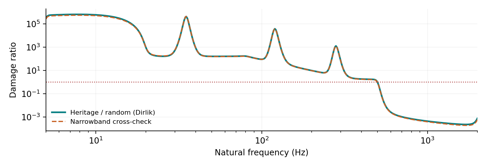

# Comparing heritage sine qualification with random vibration requirements

## A response-based fatigue severity method

Technical white paper | Vibration Damage Comparison v1.0.2 | 11 October 2026

Prepared for Alex Jordan's useful-tools repository. The companion is a single-file, offline HTML application. This paper specifies the implemented model and its interpretation; it does not establish a component-specific qualification disposition.

### The engineering question

A component survived a historical program that swept through a sine specification, identified resonances, and dwelled at those resonances. A new requirement is specified as acceleration power spectral density (PSD). The useful comparison is the cyclic response produced in the hardware, including exposure time. Matching the input G level, overall gRMS, or total input energy does not establish fatigue equivalence.

The implemented method filters both inputs through a bank of linear single-degree-of-freedom (SDOF) oscillators. It calculates a relative-displacement fatigue-damage index at each natural frequency. Sine cycles are counted directly from the specified sweep and dwell schedule. Random cycles are estimated with Dirlik's spectral method, with a narrowband/Rayleigh cross-check. A separate peak-response screen prevents a fatigue comparison from concealing a larger instantaneous-response demand.

The illustrative case intentionally shows strong coverage near documented dwells and a gap at higher frequencies. It is not a prediction for Alex's hardware. The oscillator bank represents alternative possible modes, not simultaneous physical modes whose damage can be added.

@@page

## 1. Method selection and the evidence hierarchy

| Approach | What it compares | Role in this work |
| --- | --- | --- |
| Base G, gRMS or energy | Excitation amplitude or integrated power | Input sanity check; insufficient fatigue comparison |
| Response FDS | Mode-by-mode fatigue severity under common dynamics | Implemented first-level method when response data are limited |
| Correlated stress transfer functions | Critical-location stress response to each excitation | Preferred refinement when model or test response data are available |
| Stress time histories and rainflow | Actual or simulated fatigue cycles | Refinement for transient sweeps, complex spectra or borderline results |

The spectral literature provides both narrowband formulas and empirical estimates for broadband Gaussian response, including Dirlik and Tovo-Benasciutti [1,2]. This release implements Dirlik and narrowband calculations; it does not implement Tovo-Benasciutti, stress-FRF import, time-history synthesis, or rainflow counting. NASA NESC also provides training specifically on using fatigue to compare sine and random environments [3].

### What a positive comparison means

For an assessed oscillator, heritage severity exceeding the new severity supports an exposure-coverage argument under the stated assumptions. Confidence increases when the oscillator corresponds to a measured critical mode, its damping is supported, and the displacement-to-stress relationship is unchanged. A hypothetical-bank gap identifies a frequency region to investigate; it is not proof that an actual component fails there.

### What it does not mean

Survival of one test is evidence of endurance, not a measurement of failure life or a statistical reliability demonstration. The calculation does not infer a fatigue intercept, manufacturing scatter, reliability percentile, material allowable or safety factor. These require a separate approved basis.

Design qualification and remaining life are different questions. If the very same article underwent the old qualification exposure and will now see service, its consumed test damage and future service damage accumulate. The old test cannot be treated as a credit that subtracts future fatigue. The HTML tool compares exposure severities for qualification-by-similarity reasoning; it is not a remaining-life calculator.

### Required evidence package

Retain the original specification, test report and achieved control/response data; configuration and mounting comparison; axis definition; resonance-search and dwell records; Q and fatigue-law rationale; random duration and level basis; and the disposition of all identified gaps. Do not substitute the nominal specification for achieved exposure without justification.

@@page

## 2. Reconstructing the heritage input

Displacement labeled double amplitude (DA) means peak-to-peak displacement. The corresponding zero-to-peak displacement is half the printed value. Sinusoidal velocity and acceleration labels must be checked against the historical specification: an unlabeled value must not silently be assumed to be peak or RMS.

$$x_{\mathrm{pk}}=\frac{x_{\mathrm{DA}}}{2},\qquad \omega=2\pi f$$

$$a_{\mathrm{pk}}=\omega^2x_{\mathrm{pk}}=\omega v_{\mathrm{pk}}$$

$$a_{g,\mathrm{pk}}=a_{\mathrm{pk}}/g_0,\qquad g_0=9.80665\ \mathrm{m/s^2}$$

For a sine wave only, peak = sqrt(2) times RMS. Acceleration peak-to-peak is twice peak. One inch is exactly 0.0254 m. A PSD ordinate in g²/Hz is neither a peak acceleration nor an RMS acceleration until integrated over a frequency band.

| Profile segment | Constant entered quantity | Resulting acceleration slope |
| --- | --- | --- |
| Displacement-controlled | DA or peak displacement | Proportional to frequency squared |
| Velocity-controlled | Peak or RMS velocity | Proportional to frequency |
| Acceleration-controlled | Peak, RMS or peak-to-peak G | Constant acceleration |

The tool accepts ordered, contiguous sine segments. Each segment has lower and upper frequencies, a unit code, and a level at each endpoint. Entered levels interpolate as a power law. A constant displacement or velocity segment therefore retains its correct acceleration slope after conversion. Endpoint jumps are preserved for sweeps. A dwell at a boundary with peak-G levels differing by more than one part per million requires an explicit override; the software does not choose a side.

$$y(f)=y_1(f/f_1)^p,\qquad p=\frac{\ln(y_2/y_1)}{\ln(f_2/f_1)}$$

Random PSD breakpoints use the same log-log interpolation. PSD is zero outside the supplied band; no hidden low-frequency or high-frequency extrapolation is performed. All PSD ordinates must be positive in this version. True zero-energy gaps, separate random blocks with different spectra, and discontinuous PSD steps require separate cases or a later extension. Repetitions apply to the same spectrum and level.

The sine amplitude multiplier applies to both profile-derived dwell levels and explicit dwell overrides. A PSD adjustment in dB multiplies every PSD ordinate by 10^(dB/10). Preserve tolerances, notches and qualification margins deliberately, and avoid counting an already-included margin twice.

@@page

## 3. Common response model and damage index

For base displacement y and oscillator absolute displacement x, let z = x - y. Dividing the equation of motion by mass gives:

$$\ddot z+2\zeta\omega_n\dot z+\omega_n^2z=-\ddot y,\qquad \zeta=\frac{1}{2Q}$$

$$|H_{z/a}(f)|=\frac{1}{\sqrt{(\omega_n^2-\omega^2)^2+(2\zeta\omega_n\omega)^2}}$$

The transfer function above has units s² and multiplies base acceleration in m/s². The code's transfer function includes g0 and therefore returns metres per g. At resonance, the response to base acceleration A in g peak is z_peak = g0 A Q / omega_n².

$$S_z(f)=g_0^2|H_{z/a}(f)|^2S_a(f)$$

Relative displacement is used because it is proportional to the elastic restoring-force coordinate of the oscillator. Its conversion to local stress is an assumption, not a universal component property. For a single unchanged modal stress relationship, write stress amplitude s = K z and a power-law fatigue relation N(s) = C s^(-b), where b is positive. Palmgren-Miner accumulation then motivates the normalized index below.

$$D=\sum_i\frac{n_i}{N(s_i)}=\frac{K^b}{C}\sum_i n_i z_i^b$$

$$I=\sum_i n_i\left(\frac{z_i}{z_{\mathrm{ref}}}\right)^b,\qquad z_{\mathrm{ref}}=1\ \mathrm{mm}$$

The factors K, C and the arbitrary reference displacement cancel from the heritage/new ratio only when the same fatigue law and displacement-to-stress relationship apply. I is a normalized index, not an absolute Miner damage fraction. The 1 mm reference is not an allowable. Do not compare absolute I values between different b values as though their normalizations represented the same fatigue capacity.

The engine uses cycle amplitudes, not stress ranges. Changing from amplitude to range consistently on both sides introduces a common factor 2^b that cancels in a ratio. Mixing an amplitude convention on one side with a range convention on the other does not cancel and can cause a large error.

@@page

## 4. Sine dwell and sweep accumulation

For dwell j, the actual excitation frequency is f_j. A zero override requests the profile-derived peak G level; a positive override specifies peak G directly. A zero time or cycle cap disables that cap. At least one cap must be positive.

$$t_j=\min\left(t_{\mathrm{cap},j},\frac{N_{\mathrm{cap},j}}{f_j}\right),\qquad n_j=r_j f_jt_j$$

$$I_{\mathrm{dwell}}(f_n)=\sum_j n_j\left(\frac{g_0A_j|H_{z/a}(f_j)|}{z_{\mathrm{ref}}}\right)^b$$

Only listed dwells contribute. Each listed dwell excites every evaluated oscillator through its off-resonant or resonant transfer function; the engine does not move a dwell to each bank frequency. Enter actual achieved caps when a test was stopped early. Resonance tracking, changing levels or migrating resonances are not simulated; subdivide the schedule into documented fixed-frequency exposures if that approximation is justified.

### Eight hours or one million cycles, whichever comes first

| Dwell frequency | Effective duration | Credited cycles |
| --- | --- | --- |
| 10 Hz | 8.000 hours | 288,000 |
| 34.722 Hz, approximately | 8.000 hours, approximately | 1,000,000 |
| 100 Hz | 2.778 hours | 1,000,000 |
| 1,000 Hz | 0.278 hours | 1,000,000 |

For a slowly varying sweep, instantaneous response is approximated by the steady-state sine response at the current frequency. The number of cycles in an interval is f dt. With P one-way traversals:

$$I_{\mathrm{sweep}}=P\int_{f_L}^{f_U} f\left(\frac{z_{\mathrm{pk}}(f)}{z_{\mathrm{ref}}}\right)^b\frac{dt}{df}\,df$$

For an octave rate r in oct/min, dt/df = 60/(r ln(2) f). For a linear rate v in Hz/min, dt/df = 60/v. Up and down together are two one-way traversals. Sweeps are accumulated over all segments. The total heritage index is I_H = I_dwell + I_sweep.

Set traversals to zero when resonance-search sweeps should not receive endurance credit. Start/stop transients, phase, controller behavior and fast sweep passage are omitted. The quasi-steady warning and short-dwell checks on page 9 identify cases needing closer review.

@@page

## 5. Random response and spectral moments

The random model assumes a zero-mean, stationary Gaussian process with the entered one-sided PSD. The response PSD is integrated over the supplied excitation band, even when the evaluated natural frequency lies outside that band.

$$m_j=\int_0^{\infty} f^j S_z(f)\,df,\qquad j=0,1,2,4$$

$$\sigma_z=\sqrt{m_0},\quad \nu_0=\sqrt{m_2/m_0},\quad \nu_p=\sqrt{m_4/m_2}$$

These moments use frequency in Hz. Consequently the crossing and peak-rate formulas above contain no 1/(2 pi). Formulas using angular-frequency moments do contain that factor. This convention is tested explicitly in the implementation.

### Narrowband / Rayleigh cross-check

For narrowband Gaussian response, cycle amplitudes have a Rayleigh distribution with scale sigma_z. Integrating amplitude raised to b against that distribution produces:

$$I_{\mathrm{NB}}=T\nu_0\left(\frac{\sqrt{2}\sigma_z}{z_{\mathrm{ref}}}\right)^b\Gamma(1+b/2)$$

T is the total random duration in seconds. The tool multiplies entered minutes by 60 and by the number of identical exposures. The narrowband method is often conservative relative to broadband rainflow estimates [2]; that tendency does not compensate for incorrect structural assumptions, unrepresented peaks or non-Gaussian loading.

### Dirlik parameters

Dirlik approximates the distribution of normalized rainflow amplitudes with one exponential and two Rayleigh terms [1,2]. It uses four response moments. Define:

$$\alpha=\frac{m_2}{\sqrt{m_0m_4}},\qquad x_m=\frac{m_1}{m_0}\sqrt{\frac{m_2}{m_4}}$$

$$D_1=\frac{2(x_m-\alpha^2)}{1+\alpha^2},\qquad R_D=\frac{\alpha-x_m-D_1^2}{1-\alpha-D_1+D_1^2}$$

$$D_2=\frac{1-\alpha-D_1+D_1^2}{1-R_D},\qquad D_3=1-D_1-D_2$$

$$q_D=\frac{1.25(\alpha-D_3-D_2R_D)}{D_1}$$

@@page

## 6. Dirlik damage and comparison quantities

R_D and q_D are distribution parameters, unrelated to the damage ratio and oscillator Q. The CSV labels them Dirlik_R and Dirlik_Q. Alpha near one indicates narrowband response, not qualification confidence.

Integrating the Dirlik amplitude distribution with the same power-law fatigue model gives the implemented damage index [2, equation 32]:

$$I_{\mathrm{DK}}=T\nu_p\left(\frac{\sigma_z}{z_{\mathrm{ref}}}\right)^b\left[D_1q_D^b\Gamma(1+b)+2^{b/2}\Gamma(1+b/2)(D_2|R_D|^b+D_3)\right]$$

The absolute value in the R_D term follows the cited formulation. A negative R_D is not itself a failure: its Rayleigh scale enters through its magnitude. Invalid or nonfinite coefficients stop the calculation rather than silently returning a favorable result. For 1 - alpha < 10^-7, the limiting narrowband expression is used and is labeled 'Rayleigh limit' in the export.

The analyst selects Dirlik or narrowband as the governing random model. Both ratios remain plotted. Their difference is model sensitivity, not a statistical uncertainty interval. The default is Dirlik because response spectra need not be narrowband. For unusual response spectra or decisions close to the boundary, compare against measured or synthesized stress histories and rainflow, using an independently justified workflow.

### Damage coverage and equivalent duration

$$R_I=\frac{I_H}{I_R},\qquad C_I=\frac{R_I}{F_D}$$

F_D is the user-entered required damage ratio, at least one. C_I at least one means the selected model meets that target at that oscillator. The summary reports the minimum C_I within the full bank or the explicitly selected known modes. An analyst-entered F_D is not a standard-derived acceptance factor.

$$T_{\mathrm{eq}}=T R_I,\qquad s_A=C_I^{1/b},\qquad s_{\mathrm{PSD}}=C_I^{2/b}$$

T_eq is the duration of the unchanged random spectrum that would yield the heritage index. s_A and s_PSD are the uniform input-amplitude and PSD multipliers that bring the new exposure to the requested damage ratio. These scalings hold only for fixed dynamics, spectrum shape and the single power-law fatigue model. They are not recommendations to change a test level without engineering review.

### Separate peak-response screen

$$C_P=\frac{\max(z_{\mathrm{pk,heritage}})}{k\sigma_z}$$

The numerator is the largest response during a credited sweep or dwell. The denominator uses the selected k; no fixed k, including the example value four, bounds every peak of every duration. This screen does not evaluate yield, ultimate strength or failure probability. Strength, clearance and functional checks need physical limits and justified duration-dependent extremes.

@@page

## 7. Ground rules and limits of applicability

| Ground rule | Required engineering action |
| --- | --- |
| Common dynamics and stress mapping | Establish equivalent configuration, mounting, boundary conditions, mass, preload and mode shapes. Use measured response or a correlated model when these changed. |
| Linear elastic high-cycle response | Check for plasticity, contact, stops, loose joints and amplitude-dependent damping or frequency shifts. The model has no nonlinear response correction. |
| Common fatigue law | Justify b and the stress relationship for the governing failure mechanism. The default b = 6 is illustrative, not an allowable for any material. |
| Stationary Gaussian random response | Investigate kurtosis, deterministic tones, intermittency and nonstationarity. Identical PSDs need not imply identical fatigue for non-Gaussian histories. |
| Sequential exposure accumulation | Sum sweeps and dwells because they occur in separate time blocks. Do not sum separately calculated fatigue for simultaneous random frequency bands or simultaneous axes. |
| Single-axis / single modal proxy | Evaluate each required axis. Physical multimode stress superposition can require complex stress FRFs or time histories; do not sum the FDS ordinates. |
| No fatigue threshold or sequence model | This release omits mean-stress correction, endurance limits, bilinear S-N curves, crack growth and overload interaction. |
| Credible legacy evidence | Verify test completion and pass criteria; achieved dwell frequency, response, level and duration matter more than a nominal procedure. |

### Important exclusions

The relative-displacement proxy may be unsuitable for a local connector, solder joint, fretting interface or contact-driven failure unless its relationship to damage is established. The tool does not determine whether these mechanisms govern. It also does not certify that a passed sine endurance test replicated every function exercised under random vibration.

For a configuration change, modal frequency can shift enough to change the comparison. Run bounding measured frequencies or a sufficiently dense bank. The Q/b matrix holds both exposures at the same Q for each scenario; it does not model a legacy article and a new article having different damping or different modal stress conversion.

The numerical range Q = 0.5 to 100 and b = 2 to 12 is an implementation limit, not a statement that every case inside it is physically valid. The program assumptions, certification basis and responsible engineer determine applicability.

@@page

## 8. Numerical implementation and verification

The deliverable is one HTML file with embedded JavaScript and SVG plots. It requires no server, package installation, network request or external plotting service. Inputs remain in the browser. Development sources are retained separately, and build.mjs assembles the standalone HTML deterministically.

### Integration and modal grid

The engine uses eight-point Gauss-Legendre quadrature in logarithmic excitation frequency. Intervals include all input breakpoints, a background grid of at least 12 intervals/octave, and added points around each evaluated resonance scaled by damping. Response moments and sine damage use the same physical transfer function. The base PSD integral for gRMS is analytic for each power-law segment, including the inverse-frequency special case. Sweep peaks evaluate segment endpoints and all interior stationary points of the power-law acceleration times the response transfer function.

The displayed bank defaults to 48 points/octave. Known modes, inspection frequency, dwells and input boundaries are inserted exactly. The software doubles the background integration density at the governing nominal point and reports the change in damage ratio. A change above 0.5% triggers a warning. This is an integration check; it does not prove that the modal grid captured the true continuous minimum. Repeat with 96 or 192 points/octave and narrower modal bounds near a decision boundary.

### Quasi-steady diagnostics

With resonant decay time tau = Q/(pi f_n), the sweep indicator below estimates the frequency traversed in one decay time relative to a damping bandwidth. It is evaluated at segment lower boundaries using the selected Q.

$$\epsilon=\frac{|\dot f|}{2\pi\zeta^2 f^2}$$

The warning threshold epsilon > 0.1 is a documented engineering heuristic in this implementation, not a limit prescribed by a cited standard. A dwell shorter than five resonant decay time constants also warns. The checks do not turn the steady-state solver into a transient solver. When material, exclude sweep credit or perform a transient analysis; steady-state error is not guaranteed to be conservative in every case.

### Verification performed for version 1.0.2

Eighteen automated groups check unit conventions, PSD integration, resonant response, dwell caps, damage/rate scaling, off-resonant dwells, mode insertion, invalid inputs, boundary ambiguity, exact sweep peaks and published reference results.

Independent SciPy integration of 96 frequency/Q/b combinations gives a maximum relative difference of 6.43 x 10^-12 in response moments and sweep/dwell indices. Separately reconstructed Dirlik coefficients and numerical PDF integration agree within 10^-6 in damage. Another 32 cases verify both sweep laws and peak locations. The pinned FLife regression matches all six published decimals. TECHNICAL_AUDIT.md and its PDF provide results, tolerances, source traceability and the importable example. These are calculation checks, not experimental hardware validation.

@@page

## 9. Worked checks and example interpretation

### A useful hand calculation

Take a single 100 Hz mode with Q = 10, a 2 g peak sine dwell, and a one-million-cycle limit. The 8-hour time limit does not govern. The effective duration is 10,000 s, or 2.7778 hours. At resonance:

$$z_{\mathrm{pk}}=\frac{9.80665(2)(10)}{(2\pi100)^2}=0.49681\ \mathrm{mm}$$

For b = 6 and z_ref = 1 mm, the dwell index is approximately 15,036. An independent hypothetical narrowband random response with sigma_z = 0.1 mm, nu_0 = 100 Hz and T = 3,600 s has index:

$$I_{\mathrm{NB}}=(3600)(100)(\sqrt{2}\cdot0.1)^6\Gamma(4)=17.28$$

The corresponding damage ratio is about 870. This is a response-level check, not a base-PSD specification. In particular, equal RMS sine and narrowband random responses do not have equal fatigue: at equal cycle rate and duration, the random-to-sine index ratio is Gamma(1 + b/2), which equals six for b = 6.

### The bundled illustrative case

The example combines DA displacement from 5 to 20 Hz, constant velocity from 20 to 80 Hz, constant peak acceleration from 80 to 500 Hz, and dwells at 35, 120 and 280 Hz. Each dwell has an eight-hour or one-million-cycle cap. Two one-way sweeps at one octave/minute are included. The new PSD spans 20 to 2,000 Hz for 60 minutes and integrates to approximately 6.058 gRMS.

With Q = 10, b = 6 and Dirlik damage, the 120 Hz oscillator has a damage ratio of about 37,160 and a peak-screen ratio of about 2.39 for k = 4. This large local fatigue ratio comes primarily from the documented 120 Hz dwell. It cannot be generalized to every mode.

Across the full illustrative bank, the minimum damage ratio is approximately 0.000232 near 1,706 Hz, where the sine program had no direct resonance dwell. The peak screen must be reviewed separately. If the hardware has no fatigue-critical modes in that region, the next step is to justify that fact from modal or stress evidence. If it does have such modes, the gap calls for a refined response analysis or additional qualification evidence.

The example is intentionally not a successful qualification case. Replace all inputs, including assumed Q, b, durations and known modes, before analyzing a real component.

@@page

## 10. Using the tool to support a determination

1. Build a traceable case. Enter the component, axis and evidence notes. Record the legacy specification and achieved test report, the new requirement revision, and why the configurations are comparable.

2. Reconstruct the exposure. Confirm DA, peak/RMS conventions, segment transitions, one-way sweep count, dwell frequencies and the earlier-of time/cycle rule. Remove unjustified sweep credit. Resolve notches or resonance tracking from records.

3. Establish the response assumptions. Start with a sufficiently broad oscillator bank. Use measured damping and critical modes where available. Add modal-frequency bounds. Treat the default Q/b matrix as sensitivity scenarios, not qualified material data.

4. Examine both comparisons. Inspect the fatigue ratio, separate peak screen and the response PSD at critical modes. A large fatigue ratio does not resolve an unmet peak constraint. Compare Dirlik and narrowband results when broadband response or a close margin makes method choice important.

5. Resolve gaps and instability. Refine the mode grid, vary reasonable parameters and investigate modes controlling the result. Use correlated stress response, measured histories or transient/rainflow methods where the SDOF proxy or steady-state assumptions are insufficient.

6. Preserve the record. Export the case JSON, complete CSV and self-contained HTML analysis report. The report can be printed to PDF. Attach the source evidence and this versioned method paper to the engineering disposition.

### Recommended disposition content

State the assessment scope, configuration/axis equivalence, controlling modes, damage target, Q/b basis, numerical resolution, governing damage and peak ratios, sensitivity envelope, assumptions requiring closure and final approval authority. If only selected known modes govern the summary, identify the evidence that the mode list is complete for the damage mechanisms of concern.

### References and source roles

[1] Dirlik, T., and Benasciutti, D. (2021). Dirlik and Tovo-Benasciutti Spectral Methods in Vibration Fatigue: A Review with a Historical Perspective. Metals, 11(9), 1333. https://doi.org/10.3390/met11091333. Method provenance and spectral-fatigue assumptions. Open-access author/publisher paper.

[2] Zorman, A., Slavic, J., and Boltezar, M. (2023). Vibration fatigue by spectral methods: A review with open-source support. Mechanical Systems and Signal Processing, 190, 110149. https://doi.org/10.1016/j.ymssp.2023.110149. Spectral conventions, narrowband context and Dirlik equations 30-32; author-hosted full text reviewed.

[3] Irvine, T. NASA NESC Academy. Shock & Vibration: 41. Using Fatigue to Compare Sine and Random Environments. https://nescacademy.nasa.gov/video/2584e207341e411b95fa829e191d81441d. Related training resource; not an approval of this tool. The linked slides were not available during preparation and are not used as an equation source.

Sources checked 11 October 2026. The governing program must supply its acceptance rules. Reconstruction rules, software diagnostics, examples and workflow describe this implementation.
